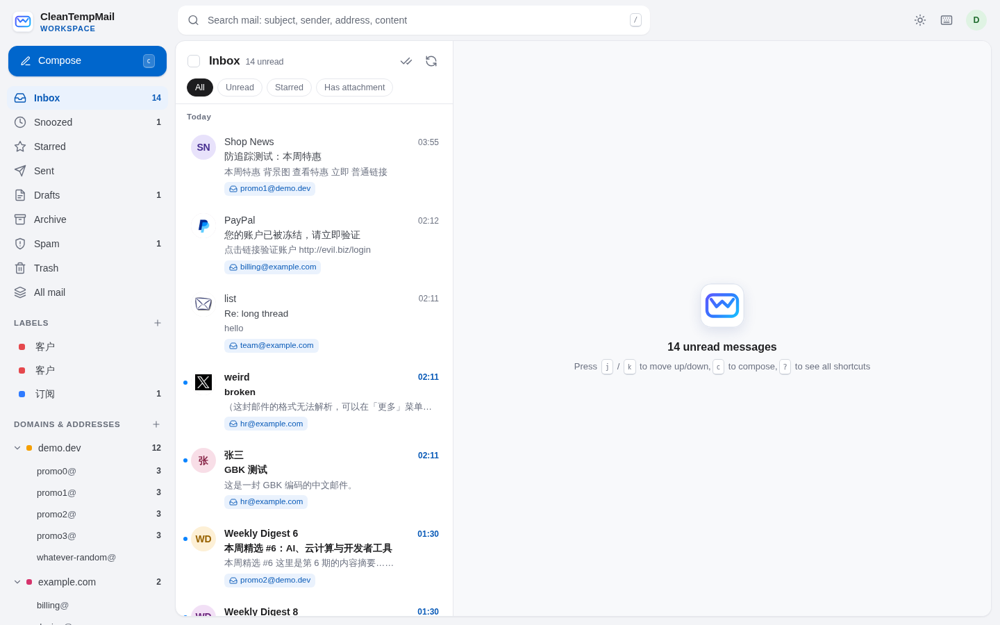

# CleanTempMail Workspace


[中文](README.md) · [Deploy](#deploy) · [Update](#updating)

| Standard (needs R2) | No-card (D1 + KV) |
|---|---|
| [](https://deploy.workers.cloudflare.com/?url=https://github.com/cleantempmail/cleantempmail-workspace) | [](https://deploy.workers.cloudflare.com/?url=https://github.com/cleantempmail/cleantempmail-workspace/tree/lite) |

A self-hosted, multi-domain mailbox that runs entirely in your own Cloudflare account (a separate product from the public CleanTempMail disposable-mail service).

Sign in with Cloudflare, pick domains from your account, and inbound and outbound mail are set up in one click:

- **Catch-all by default**: `anything@your-domain` is delivered, with no mailboxes to create first
- **Multiple domains**: the sidebar groups mail by domain and address; addresses can have notes and colors
- **Reply from the receiving address**: mail sent to `sales@a.com` is answered from `sales@a.com`, with `In-Reply-To` / `References`
- **Choice of sending service**: Cloudflare Email Sending or Resend, chosen per domain, with automatic failover between them
- **Tracking protection on by default**: tracking pixels removed, remote images loaded through a privacy proxy, tracking parameters stripped from links

All data (D1 + R2, or D1 + KV in no-card mode) stays in your account. The UI is available in Chinese and English.



## Deploy

Everything is created in your own Cloudflare account. Use **one-click deploy** (nothing to install) or the **command line** (if you want to change the code).

### Requirements

- A Cloudflare account, with the domains you want to receive mail on using Cloudflare DNS
- Storage, one of:
  - **Standard**: enable **R2** in the dashboard (10 GB free; Cloudflare asks for a card when you enable it)
  - **No-card**: no R2; mail is stored in D1 and KV, which need no card but hold less. See [No-card mode](#no-card-mode)
- One of the following sending services (or both, as backups for each other):
  - **Cloudflare Email Sending**: requires Workers Paid ($5/month)
  - **Resend**: sign up at [resend.com](https://resend.com) and create an API key (free plan: 100 emails/day, 3,000/month, up to 3 domains)

### Option A: one-click deploy

| Standard (needs R2) | No-card (D1 + KV) |
|---|---|
| [](https://deploy.workers.cloudflare.com/?url=https://github.com/cleantempmail/cleantempmail-workspace) | [](https://deploy.workers.cloudflare.com/?url=https://github.com/cleantempmail/cleantempmail-workspace/tree/lite) |

1. Use **Standard** if R2 is enabled on your account, otherwise **No-card**. Sign in to Cloudflare and connect your GitHub (or GitLab) account when asked
2. Set the repository name, Worker name and database / storage names (the defaults are fine), then deploy. Cloudflare copies the code into your GitHub, creates the databases and storage (Standard: D1 + R2; No-card: two D1 databases + KV), deploys, and runs the migrations
3. Open the deployed address, `https://<worker-name>.<your-subdomain>.workers.dev`, and follow the three setup steps: click "Create token on Cloudflare" (the permissions are preselected) → paste the token back → set an admin password. No OAuth client and no environment variables needed
4. You land in the mailbox; add a domain (same as [step 5](#5-add-a-domain) below)

To use your own hostname: open the Worker in the dashboard → **Settings → Domains & Routes → Add → Custom domain**.

**Updating**: the copy in your GitHub doesn't pick up new versions automatically. In your repository, run the commands below; after the push, Cloudflare redeploys and migrates the database automatically:

```bash
git remote add upstream https://github.com/cleantempmail/cleantempmail-workspace.git   # once
git pull upstream main     # no-card version: git pull upstream lite
git push
```

If `wrangler.jsonc` conflicts, keep your own `name`, `database_id` and KV `id`.

### Option B: command line

Requires [Node.js](https://nodejs.org/) 20+ and git.

### 1. Get the code

```bash
git clone https://github.com/cleantempmail/cleantempmail-workspace.git
cd cleantempmail-workspace
npm install
```

### 2. Optional: use your own hostname

By default the app is served at `https://cf-mailbox.<your-subdomain>.workers.dev`. To use your own hostname, copy the example file:

```bash
cp wrangler.local.example.jsonc wrangler.local.jsonc
```

Replace `mail.example.com` with your hostname (it must be on a zone in your account; Cloudflare creates the DNS record and certificate). This file isn't committed; `npm run deploy` applies it on top of `wrangler.jsonc`, so `git pull` never conflicts.

You can also deploy on workers.dev first and add a custom domain later under the Worker's **Settings → Domains & Routes**.

### 3. Deploy

```bash
npx wrangler login     # authorize wrangler in your browser
npm run deploy         # first deploy: creates the databases and storage, deploys the Worker, runs migrations
```

The deploy script picks the storage automatically: R2 if it's enabled on your account, otherwise [no-card mode](#no-card-mode). Force one with `STORAGE=lite npm run deploy` or `STORAGE=r2 npm run deploy`.

### 4. Finish the first-run setup

Open your app address. The setup page has three steps:

1. Click "Create token on Cloudflare": the permissions are preselected. Under "Account Resources" pick the account this app is deployed in, click "Continue to summary" → "Create Token", and copy the token
2. Paste the token back
3. Set an admin password (at least 10 characters)

The token is encrypted and kept only in your database; it's used to list domains and set up receiving and sending. Only someone who can create a token for the account this app runs in can finish setup, so nobody else can claim the admin role first.

<details>
<summary>Token permissions (add them by hand if the link didn't preselect them)</summary>

`User Details · Read`, `Account Settings · Read`, `Workers Scripts · Read`, `Zone · Read`, `Zone Settings · Edit`, `DNS · Edit`, `Email Routing Rules · Edit`, `Email Sending · Edit`, and optionally `Analytics · Read` (shows "Delivered / Rejected" on sent mail). Account resources: the account this app is deployed in; zone resources: all zones.
</details>

After signing in you can add a passkey (fingerprint / face / device PIN) under **Settings → Account & security**. If you forget the password, click "Forgot password?" on the sign-in page and reset it with an API token for the same account.

### 5. Add a domain

1. Go to **Domains → Add domain** and pick a domain from your account
2. The app turns on Email Routing, points the catch-all at this Worker, and sets up sending (Cloudflare if you have Workers Paid, otherwise Resend)

If the domain already uses another mail provider (e.g. Google Workspace MX records), you're asked to confirm before they're replaced, and the old records are backed up. DNS changes usually take a few minutes.

### 6. Optional

- **Send with Resend**: add your Resend API key under **Settings → Sending**, then choose Resend from the ⋮ menu on the domain card
- **Resend domain slots**: Resend's free plan allows 3 domains, and every domain in the account takes a slot whether or not it's verified or still used by this app. **Settings → Sending** shows the usage. For a domain you rarely send from, choose "Stop sending with Resend (free up a slot)" in its menu: it's deleted from Resend and its DNS records are removed, so the slot can go to another domain (setting it up again later rewrites the DNS records). Removing a domain offers the same option
- **Backup sending**: when both services are available, turn on the "Backup" switch on the domain card. If the primary service is out of quota, unverified or failing, mail goes out through the other one; messages over Cloudflare's 5 MB limit also go through Resend
- **Team members**: invite colleagues under **Settings → Team members**; they sign in with an emailed link and don't need a Cloudflare account
- **Push notifications**: turn on under **Settings → General** to get new-mail alerts even when the page is closed
- **Separate encryption key**: tokens and the Resend API key are encrypted with a random key stored in the database. To keep the key apart from the data, set `APP_SECRET` (`openssl rand -base64 32 | npx wrangler secret put APP_SECRET`) and don't change or delete it afterwards
- **Sign in with Cloudflare (OAuth)**: besides password and passkeys, you can configure a private OAuth client to get a "Sign in with Cloudflare" button, see below

<details>
<summary>Configure Cloudflare OAuth sign-in (optional)</summary>

In the Cloudflare dashboard, open **Manage Account → OAuth clients → Create client**:

| Field | Value |
|---|---|
| Redirect URL | `https://<your-app-address>/auth/callback` (must match exactly) |
| Response type | `Code` |
| Grant types | `Authorization Code`, `Refresh Token` |
| Token auth method | `Client Secret Basic` |
| Scopes | `user-details.read` `account-settings.read` `workers-scripts.metadata_read` `zone.read` `zone-settings.write` `dns.read` `dns.write` `email-routing-rule.read` `email-routing-rule.write` `email-sending.read` `email-sending.write` |
| Optional scope | `analytics.read` |

Then store the client ID and secret as Worker secrets (or add them under the Worker's **Settings → Runtime variables and secrets**):

```bash
npx wrangler secret put CF_OAUTH_CLIENT_ID
npx wrangler secret put CF_OAUTH_CLIENT_SECRET
```

Or use the script (needs an API token with OAuth Clients Write): `CLOUDFLARE_API_TOKEN=... CLOUDFLARE_ACCOUNT_ID=... ./scripts/create-oauth-client.sh https://<your-app-address>`
</details>

### Updating

```bash
git pull
npm install
npm run update    # migrates the database first, then deploys, so mail keeps flowing during the update
```

### No-card mode

Cloudflare asks for a card when you enable R2 (nothing is charged within the free tier). If you'd rather not add one, no-card mode skips R2 and stores mail in D1 and KV, which need no card.

| Content | Stored in |
|---|---|
| Message bodies, plain-text raw messages, attachments up to 512 KB | D1 (a separate storage database, 500 MB free) |
| Larger attachments and raw messages | KV (1 GB free) |

Limits to know:

- **Capacity**: 500 MB of D1 holds tens of thousands of ordinary emails; KV's 1 GB is mostly used by large attachments. Check usage under **Settings → Data**; it turns red when nearly full
- **KV allows 1,000 writes a day**: only files over 512 KB use it, ordinary mail never does. A day with lots of large attachments may run out
- **Fresh large attachments**: KV takes a few seconds to tens of seconds to replicate globally, so another region may need a moment before it can open one
- The storage mode is fixed after the first deploy and won't switch automatically if you enable R2 later (so old mail stays readable). Migrating existing mail to R2 isn't supported yet

### Troubleshooting

- **Setup says the token is invalid**: the token needs at least "Account Settings · Read" and "Workers Scripts · Read", and "Account Resources" must be the account this app is deployed in
- **Forgot the admin password**: click "Forgot password?" on the sign-in page and paste an API token for the same account
- **redirect_uri mismatch when signing in with OAuth**: the OAuth client's Redirect URL must exactly match your app address, including `https://` and `/auth/callback`
- **Mail isn't arriving**: click "Health check" on the domain card. It checks Email Routing, MX, catch-all, SPF and DMARC and can fix them in one click
- **Cloudflare sending fails**: usually the account doesn't have Workers Paid. Switch to Resend, or set Resend as the backup
- **Resend says the domain slots are full**: the free plan allows 3 domains. Free one up (see step 7) or upgrade your Resend plan. With many domains, Workers Paid with Cloudflare sending is simpler: 3,000 emails/month included and no limit on the number of domains
- **AI features unavailable**: summaries, translation and reply drafts use Workers AI, which has a daily free allowance

## Plans

| | Workers Free | Workers Paid ($5/month) |
|---|---|---|
| Receiving (Email Routing + Worker) | ✅ (very large messages may exceed CPU limits; the raw message is still kept) | ✅ |
| Cloudflare Email Sending to any recipient | ❌ | ✅ (beta; new accounts start with a low daily quota) |
| Sending through Resend | ✅ | ✅ |
| Workers AI | Daily free allowance | Daily free allowance + pay as you go |

Limits: 50 recipients per message; outgoing size 5 MiB with Cloudflare / 20 MiB with Resend; incoming up to 25 MiB.

## Local development

```bash
printf 'DEV_LOGIN=1\n' > .dev.vars      # local requests only: skips OAuth
npm run db:local
npm run dev
# simulate inbound mail:
curl -X POST "http://localhost:8787/cdn-cgi/handler/email?from=a@gmail.com&to=hi@example.com" --data-binary @test.eml
```

See [README.md](README.md) for the full feature list, security notes and code layout (in Chinese).

## License

[MIT](LICENSE)
