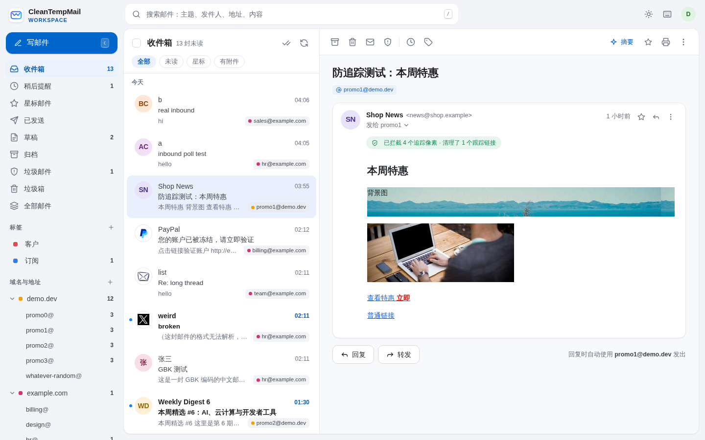
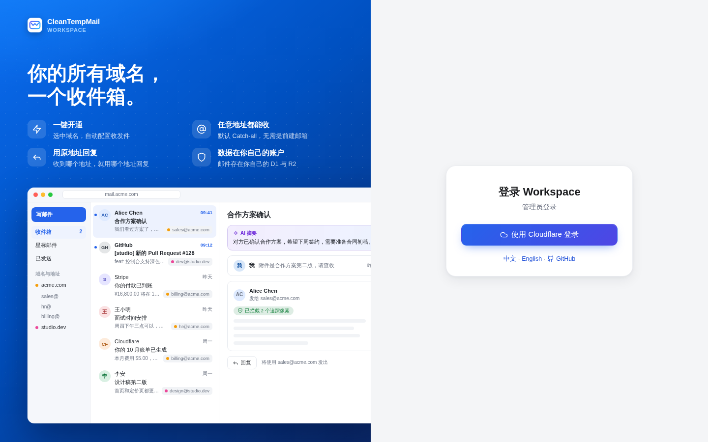
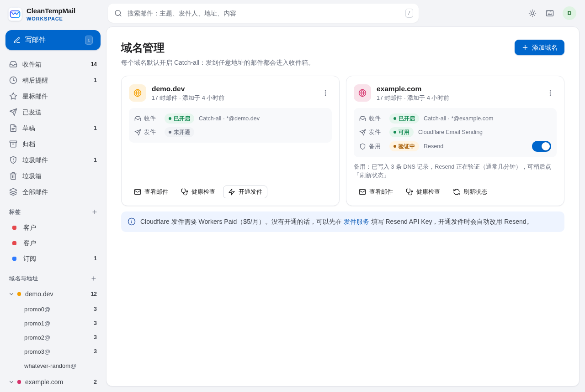
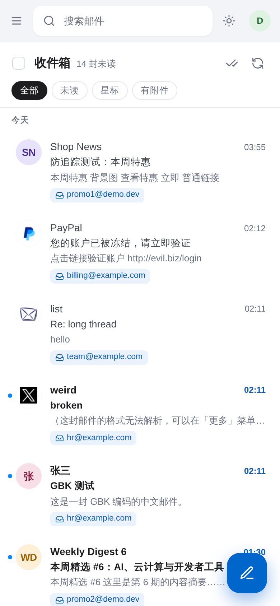

# CleanTempMail Workspace


[English](README.en.md) · [部署教程](#部署) · [更新](#更新到新版本)

| 标准版（需开通 R2） | 免绑卡版（D1 + KV） |
|---|---|
| [](https://deploy.workers.cloudflare.com/?url=https://github.com/cleantempmail/cleantempmail-workspace) | [](https://deploy.workers.cloudflare.com/?url=https://github.com/cleantempmail/cleantempmail-workspace/tree/lite) |

部署在你自己 Cloudflare 账户里的多域名邮箱工作台（与公开的 CleanTempMail 临时邮箱是两个独立产品）。

用 Cloudflare 账户登录，从账户里选域名，一键开通收件和发件：

- **默认 Catch-all**：`任意地址@你的域名` 都能收，不需要提前创建邮箱
- **多域名**：侧栏按域名、按地址分组，地址可以加备注和颜色
- **原地址回复**：发到 `sales@a.com` 的邮件，回复时自动用 `sales@a.com` 发出，并带上 `In-Reply-To` / `References`
- **发件服务可选**：Cloudflare Email Sending 或 Resend，按域名切换，也可以互为备用、出问题时自动切换
- **默认防追踪**：拦截追踪像素，远程图片经隐私代理加载，清理链接里的跟踪参数

所有数据（D1 + R2）都在你自己的账户里。



| 登录页 | 防追踪 |
|---|---|
|  |  |
| **备用发件** | **手机** |
|  |  |

## 功能

**收件与整理**
- 会话视图（原始主题 + 最新摘要）、按日期分组、星标、归档、垃圾箱（30 天自动清理）、批量操作、撤销
- 多标签、收信规则（按收件地址/发件人/主题/正文/附件自动打标签、归档、星标、标已读、转发）
- 稍后提醒（到点回到收件箱顶部）
- 全文搜索（中文按字切分），支持 `from:` `to:` `subject:` `has:附件` `is:未读` `is:星标` `before:` `after:` `in:trash`

**防垃圾（Catch-all 必备）**
- 显示 Cloudflare 收信时的 SPF / DKIM / DMARC 结果：「已验证」标识，DMARC 失败直接进垃圾邮件并提示可能是钓鱼
- 屏蔽名单（地址或整个域名，进垃圾邮件或直接拒收）、可选按 Cloudflare 垃圾评分阈值判定、可选 Workers AI 判定陌生发件人
- 地址管理：一键**停用**泄露的地址（之后直接 SMTP 拒收）、静音通知

**写信**
- 回复默认在弹出窗口中编辑，也可以在设置里改成在会话底部直接展开（内嵌回复框）
- 浮动窗口、富文本、收件人补全、拖拽/粘贴附件（带进度）、草稿自动保存（只在真正修改过时）
- 撤销发送（关页面时会立即发出，不会丢）、**定时发送**、模板、按地址/域名/全局设置显示名和签名
- 回复和转发的引用语（「…写道：」/ `On … wrote:`）默认跟随原邮件语言，也可以固定为中文或英文
- AI 起草回复

**阅读与防追踪**
- HTML 邮件在沙箱 iframe 中显示（独立 CSP），浏览器任何时候都不会直接请求发件人的服务器
- 自动移除追踪像素（1×1 图片、隐藏图片、各邮件营销平台的打开统计地址），并显示「已拦截 N 个追踪像素」
- 远程图片经本服务的隐私代理加载（签名链接、边缘缓存），发件人看不到你的 IP、位置和设备；也可以设为「先询问」
- 自动清理链接里的跟踪参数（`utm_*`、`fbclid`、`gclid`、`mc_eid` 等），移除 `ping`、DNS 预解析、外部样式表
- 内嵌图片、引用折叠、附件预览
- 发件人品牌头像（由 Worker 代取并缓存，浏览器不直接访问第三方）
- 订阅邮件一键退订（RFC 8058 One-Click / mailto）
- AI 会话摘要、翻译

**投递**
- 备用发件：主服务明确拒发（额度、未验证、服务异常）或邮件超过它的大小上限时自动改用另一个服务；超时等无法确定是否已发出的情况不切换，避免重复发送
- 退信自动识别并关联到原邮件，已发送邮件显示「退信」及原因
- 可选：通过 GraphQL 分析接口显示「已送达 / 被拒收」（令牌需要 Analytics · Read，或 OAuth 勾选 `analytics.read`）
- 查看并解除 Cloudflare 抑制列表

**团队**
- 邀请成员（邮件登录链接，无需 Cloudflare 账户），按域名或地址授权，成员看不到范围以外的邮件

**其他**
- 域名健康检查与一键修复（Email Routing、MX、Catch-all、SPF、DMARC、发件 DNS）
- Web Push 推送（关掉页面也能收到新邮件通知）、PWA、标题与 favicon 未读数
- 深色模式、紧凑密度、可拖动列表宽度、可关闭阅读窗格、键盘快捷键（按 `?`）
- 手机端适配：底部标签栏、抽屉侧栏、阅读页滑入、滑动手势、下拉刷新
- 中文 / English 界面
- 导出 mbox、存储用量

## 部署

所有资源都创建在你自己的 Cloudflare 账户里。两种方式任选其一：**一键部署**不需要在电脑上装任何东西；**命令行部署**适合想自己改代码的人。

### 准备

- 一个 Cloudflare 账户，要收信的域名已接入 Cloudflare（DNS 托管在 Cloudflare）
- 存储二选一：
  - **标准版**：在控制台开通 **R2**（免费 10 GB，开通时需要绑卡）
  - **免绑卡版**：不用 R2，邮件存在 D1 和 KV 里，不需要绑卡，但容量较小，见下面的[免绑卡模式](#免绑卡模式)
- 发件服务二选一（也可以两个都配，互为备用）：
  - **Cloudflare Email Sending**：账户需要 Workers Paid（$5/月）
  - **Resend**：注册 [resend.com](https://resend.com) 并创建一个 API Key（免费版每天 100 封、每月 3000 封，最多 3 个域名）

### 方式一：一键部署

| 标准版（需开通 R2） | 免绑卡版（D1 + KV） |
|---|---|
| [](https://deploy.workers.cloudflare.com/?url=https://github.com/cleantempmail/cleantempmail-workspace) | [](https://deploy.workers.cloudflare.com/?url=https://github.com/cleantempmail/cleantempmail-workspace/tree/lite) |

1. 账户开通了 R2 就点「标准版」，没绑卡的点「免绑卡版」。登录 Cloudflare，按提示连接你的 GitHub（或 GitLab）账户
2. 设置仓库名、Worker 名称和数据库 / 存储桶名称，保持默认即可，然后点部署。Cloudflare 会把代码复制一份到你的 GitHub，自动创建需要的数据库和存储（标准版：D1 + R2；免绑卡版：两个 D1 + KV），完成部署和建表
3. 打开部署好的地址 `https://<Worker 名称>.<你的子域>.workers.dev`，按首次设置页的三步操作：点「在 Cloudflare 创建令牌」（权限已经预先选好）→ 把令牌粘贴回来 → 设置管理员密码。不需要创建 OAuth 客户端，也不需要填任何环境变量
4. 完成后直接进入邮箱，添加域名（同下面的[第 5 步](#第-5-步添加域名)）

想用自己的域名访问：控制台打开这个 Worker → **Settings → Domains & Routes → Add → Custom domain**。

**以后更新**：复制到你 GitHub 的仓库不会自动同步本仓库的新版本。在你自己的仓库里执行下面的命令，推送后 Cloudflare 会自动重新部署，并自动更新数据库结构：

```bash
git remote add upstream https://github.com/cleantempmail/cleantempmail-workspace.git   # 只需一次
git pull upstream main     # 免绑卡版改成：git pull upstream lite
git push
```

如果 `wrangler.jsonc` 出现冲突，保留你自己的 `name`、`database_id` 和 KV 的 `id`。

### 方式二：命令行部署

需要本机安装 [Node.js](https://nodejs.org/) 20 或更高版本和 git。

### 第 1 步：获取代码

```bash
git clone https://github.com/cleantempmail/cleantempmail-workspace.git
cd cleantempmail-workspace
npm install
```

### 第 2 步（可选）：使用自己的域名

默认部署后通过 `https://cf-mailbox.<你的子域>.workers.dev` 访问。想用自己的域名，复制示例文件：

```bash
cp wrangler.local.example.jsonc wrangler.local.jsonc
```

把里面的 `mail.example.com` 改成你的访问地址（必须是你账户里某个域名的子域名，Cloudflare 会自动创建 DNS 记录和证书）。这个文件不提交到 git，`npm run deploy` 时会自动覆盖 `wrangler.jsonc` 里的同名字段，以后 `git pull` 更新也不会冲突。

也可以先用 workers.dev 地址部署，之后在控制台 Worker → **Settings → Domains & Routes** 添加自定义域名。

### 第 3 步：部署

```bash
npx wrangler login     # 浏览器里授权 wrangler 访问你的账户
npm run deploy         # 首次部署：自动创建数据库和存储，部署 Worker，然后建表
```

部署脚本会自动判断存储方式：账户开通了 R2 就用 R2，没开通就用[免绑卡模式](#免绑卡模式)，不需要改任何配置。也可以用 `STORAGE=lite npm run deploy` 或 `STORAGE=r2 npm run deploy` 强制指定。

### 第 4 步：完成首次设置

打开你的访问地址，首次设置页只有三步：

1. 点「在 Cloudflare 创建令牌」：需要的权限已经预先选好。在「账户资源」里选择部署了本应用的账户，点「继续以显示摘要」→「创建令牌」，复制令牌
2. 把令牌粘贴回来
3. 设置管理员密码（至少 10 位）

令牌加密后只保存在你自己的数据库里，用于列出域名、配置收件和发件。只有能为部署本应用的账户创建令牌的人才能完成设置，别人无法抢先认领管理员。

<details>
<summary>令牌需要的权限（预填链接没选上时手动添加）</summary>

`User Details · Read`、`Account Settings · Read`、`Workers Scripts · Read`、`Zone · Read`、`Zone Settings · Edit`、`DNS · Edit`、`Email Routing Rules · Edit`、`Email Sending · Edit`，可选 `Analytics · Read`（显示外发邮件「已送达 / 被拒收」）。账户资源选部署了本应用的账户，区域资源选所有区域。
</details>

登录后可以在「设置 → 账户与安全」添加通行密钥（指纹 / 面容 / 设备密码），以后一键登录。忘记密码时，在登录页点「忘记密码？」，用同一个账户的 API 令牌重设。

### 第 5 步：添加域名

1. 进入「域名管理 → 添加域名」，从账户里选择要收信的域名
2. 应用会自动完成：开启 Email Routing、把 Catch-all 投递到本 Worker、开通发件服务（有 Workers Paid 用 Cloudflare，否则用 Resend）

如果域名已经在用其他邮箱（例如 Google Workspace 的 MX 记录），会先提示你确认再替换，原来的记录会备份。DNS 生效通常需要几分钟。

### 第 6 步（可选）

- **用 Resend 发件**：「设置 → 发件服务」填写 Resend API Key，然后在域名卡片右上角 ⋮ 选择 Resend
- **Resend 域名名额**：Resend 免费版最多 3 个域名，不论是否验证通过、本应用是否还在用都占名额。「设置 → 发件服务」可以看到用量；不常用的域名可以在菜单里选「停用 Resend 发件（释放名额）」，会从 Resend 删除并清理 DNS 记录，腾出名额给别的域名（之后重新开通会自动重新写入 DNS）。移除域名时也可以勾选同时释放
- **备用发件**：两个服务都可用时，打开域名卡片上的「备用」开关。主服务额度用完、未验证或出错时，自动改用另一个服务发出；邮件超过 Cloudflare 的 5 MB 上限时也会自动改用 Resend
- **团队成员**：「设置 → 团队成员」邀请同事，用邮箱登录链接登录，不需要 Cloudflare 账户
- **推送通知**：「设置 → 通用」开启后，关掉页面也能收到新邮件通知
- **单独的加密密钥**：令牌和 Resend API Key 默认用存在数据库里的随机密钥加密。想让密钥和数据分开存放，可以设置 `APP_SECRET`（`openssl rand -base64 32 | npx wrangler secret put APP_SECRET`），设置后不要再修改或删除
- **用 Cloudflare 账户登录（OAuth）**：除了密码和通行密钥，还可以配置私有 OAuth 客户端，登录页会多一个「使用 Cloudflare 登录」，见下面的说明

<details>
<summary>配置 Cloudflare OAuth 登录（可选）</summary>

在 Cloudflare 控制台打开 **Manage Account → OAuth clients → Create client**：

| 字段 | 填写 |
|---|---|
| Redirect URL | `https://<你的访问地址>/auth/callback`（必须完全一致） |
| Response type | `Code` |
| Grant types | `Authorization Code`、`Refresh Token` |
| Token auth method | `Client Secret Basic` |
| Scopes | `user-details.read` `account-settings.read` `workers-scripts.metadata_read` `zone.read` `zone-settings.write` `dns.read` `dns.write` `email-routing-rule.read` `email-routing-rule.write` `email-sending.read` `email-sending.write` |
| 可选 Scope | `analytics.read` |

然后把 Client ID 和 Client Secret 保存为 Worker Secret（也可以在控制台 Worker 的 **Settings → Runtime variables and secrets** 添加）：

```bash
npx wrangler secret put CF_OAUTH_CLIENT_ID
npx wrangler secret put CF_OAUTH_CLIENT_SECRET
```

也可以用脚本创建（需要一个有 OAuth Clients Write 权限的 API token）：`CLOUDFLARE_API_TOKEN=... CLOUDFLARE_ACCOUNT_ID=... ./scripts/create-oauth-client.sh https://<你的访问地址>`
</details>

### 更新到新版本

```bash
git pull
npm install
npm run update    # 先更新数据库结构，再部署新代码，更新过程中收发不中断
```

### 免绑卡模式

Cloudflare 开通 R2 时要求绑卡（免费额度内不扣费）。不想绑卡的话，可以用免绑卡模式：不使用 R2，邮件存在 D1 和 KV 里，这两样都不需要绑卡。

| 内容 | 存在哪里 |
|---|---|
| 邮件正文、纯文本的原始邮件、512 KB 以内的附件 | D1（单独的存储库，免费 500 MB） |
| 更大的附件和原始邮件 | KV（免费 1 GB） |
| 品牌头像缓存、写信时上传的附件 | 同上，按大小决定 |

需要知道的限制：

- **容量**：D1 存储库 500 MB 足够存几万封普通邮件；KV 的 1 GB 主要被大附件占用。用量可以在「设置 → 数据」查看，快满时会标红
- **KV 每天最多写入 1000 次**：只有大于 512 KB 的文件会用到，普通邮件一次都不用。大附件特别多的话当天可能存不下
- **大附件刚收到时**：KV 在全球同步需要几十秒，其他地区偶尔要稍等一会儿才能打开
- 存储方式在第一次部署后就固定下来，之后开通了 R2 也不会自动切换（避免旧邮件读不到）。目前还不支持把已有邮件迁移到 R2

### 常见问题

- **首次设置提示令牌无效**：令牌至少需要「Account Settings · Read」「Workers Scripts · Read」权限，并且「账户资源」要选部署了本应用的账户
- **忘记管理员密码**：登录页点「忘记密码？」，粘贴同一个账户的 API 令牌即可重设
- **使用 OAuth 登录时提示 redirect_uri 不匹配**：OAuth 客户端的 Redirect URL 必须和访问地址完全一致，包括 `https://` 和 `/auth/callback`
- **收不到邮件**：在域名卡片上点「健康检查」，会逐项检查 Email Routing、MX、Catch-all、SPF、DMARC，并可以一键修复
- **Cloudflare 发件失败**：通常是账户没有开通 Workers Paid。可以改用 Resend，或把 Resend 设为备用
- **Resend 提示名额已满**：免费版最多 3 个域名。先释放一个不常用的域名（见第 6 步），或升级 Resend 套餐。域名多的话，开通 Workers Paid 用 Cloudflare 发件更省事：每月含 3,000 封，不限域名数
- **Workers AI 功能不可用**：AI 摘要、翻译、起草回复使用 Workers AI，有每日免费额度，用完后会提示稍后再试

## 套餐说明

| | Workers Free | Workers Paid（$5/月） |
|---|---|---|
| 收件（Email Routing + Worker） | ✅（大邮件可能超出 CPU 限制，解析失败时仍会保存原文） | ✅ |
| Cloudflare Email Sending 发给任意收件人 | ❌ | ✅（Beta，新账户每日额度较低） |
| 通过 Resend 发件 | ✅ | ✅ |
| 存储 | 免绑卡版：D1 + KV（不需要绑卡）；标准版：R2 免费 10 GB（需要绑卡） | 同左 |
| Workers AI（摘要、翻译、起草、垃圾判定） | 每日免费额度 | 每日免费额度 + 按量 |

标准版需要在控制台启用一次 R2（有免费额度，需要绑卡）；免绑卡版不需要。D1 免费额度每天 500 万行读取：列表与轮询都走汇总表和计数表，日常使用远低于这个量。

限制：每封邮件最多 50 个收件人；发件总大小 Cloudflare 5 MiB / Resend 20 MiB；收件最大 25 MiB。

## 安全

- 主页面 CSP 只允许本站脚本；邮件正文在独立 CSP 的沙箱 iframe 中显示；附件只有图片/PDF 能内联打开
- 编辑器对粘贴内容、引用原文、草稿做白名单过滤
- 写请求校验 `Sec-Fetch-Site` / `Origin` 并要求 `application/json`（防同主域兄弟子域的 CSRF）
- 会话 Cookie 使用 `__Host-` 前缀；数据库只保存会话 id 的哈希
- 管理员密码用 PBKDF2 哈希保存，登录失败按 IP 和全局限流；支持通行密钥（WebAuthn）
- 首次设置和重设密码都要求提供能访问部署账户的 API 令牌，别人无法抢先认领管理员
- 设置 `APP_SECRET` 后，token 与 API Key 的加密密钥和数据分开存放
- OAuth token 刷新带条件更新，避免并发刷新互相作废

## 工作原理

| 动作 | 调用的 Cloudflare API |
|---|---|
| 登录 | 管理员密码 / 通行密钥；可选 Cloudflare OAuth（私有客户端） |
| 调用 Cloudflare API | 首次设置时粘贴的 API 令牌（加密保存）；没有令牌时用 OAuth 会话 |
| 列出域名 | `GET /zones?account.id=…`（自动翻页） |
| 开启收件 | 先 `POST /zones/{zone}/email/routing/dns`，成功后再删除（并备份）冲突的旧 MX |
| Catch-all | `PUT /zones/{zone}/email/routing/rules/catch_all` → `worker: cf-mailbox`（原规则会备份，移除域名时恢复） |
| 开通 Cloudflare 发件 | `POST /zones/{zone}/email/sending/subdomains` + `POST …/{id}/dns` |
| 开通 Resend 发件 | Resend `POST /domains` → 记录写入 Cloudflare DNS → `POST /domains/{id}/verify` |
| 收信 | Worker `email()`：原文与附件存 R2，元数据、会话汇总、全文索引存 D1 |
| 发信 | `send_email` 绑定（Cloudflare）或 Resend API，可配置互为备用 |
| 图片代理 | `GET /api/img`：只接受服务端签名过的链接，不带 Cookie / Referer，边缘缓存一天 |
| 投递状态 | GraphQL `emailSendingAdaptive` |
| 定时任务 | 每分钟：定时发送、稍后提醒、投递状态；每天：清理垃圾箱/垃圾邮件/过期附件/过期会话 |

## 本地开发

```bash
printf 'DEV_LOGIN=1\n' > .dev.vars      # 仅对本机请求生效：跳过 OAuth
# 可选：DEV_CF_API_TOKEN=<API token>    # 让本地也能调用 Cloudflare API
npm run db:local
npm run dev                              # AI 绑定需要远程连接：先 wrangler login 或设置 CLOUDFLARE_API_TOKEN
# 模拟收信：
curl -X POST "http://localhost:8787/cdn-cgi/handler/email?from=a@gmail.com&to=hi@example.com" --data-binary @test.eml
```

## 目录

```
src/index.ts             入口：fetch（API + 静态页）、email（收信）、scheduled（定时任务）
src/auth.ts              首次设置、密码 / 通行密钥 / OAuth 登录、成员邮件登录、会话、CSRF
src/local-auth.ts        密码哈希、登录限流、通行密钥（WebAuthn）校验
src/routes/account.ts    账户与安全：修改密码、通行密钥、更换 API 令牌
src/provision.ts         一键配置域名、健康检查与修复
src/storage.ts           文件存储：R2，或免绑卡模式的 D1 + KV
src/providers.ts         发件服务：Cloudflare / Resend，判断错误是否可以切换到备用服务
src/privacy.ts           防追踪：追踪像素识别、链接参数清理、图片隐私代理
src/mail.ts              收信解析、会话归类、存储、彻底删除
src/threads.ts           会话汇总表、地址计数、历史数据回填
src/search.ts            全文搜索（FTS5 + 中文切分）与搜索语法
src/filters.ts           发件人验证结果、屏蔽名单、规则、AI 垃圾判定
src/bounce.ts            退信识别
src/push.ts              Web Push（VAPID）
src/cron.ts              定时任务
src/scope.ts             团队成员的访问范围
src/routes/messages.ts   会话列表、整理操作、HTML 正文、附件、退订、统计
src/routes/compose.ts    上传、草稿、联系人、身份、模板、发送、定时发送
src/routes/org.ts        地址、屏蔽名单、规则、标签、成员、推送、AI、导出、投递状态、品牌头像
public/js/               前端（原生 ES 模块，无构建步骤）
public/sw.js             Service Worker（推送通知）
public/brand/            logo 与图标
scripts/deploy.mjs       部署：自动选择存储方式、先迁移数据库再部署
scripts/lite-config.mjs  生成免绑卡版配置（.github/workflows/lite-branch.yml 用它维护 lite 分支）
```

## 许可证

[MIT](LICENSE)
